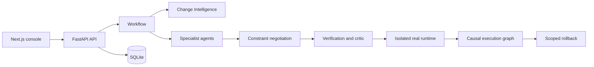

# MEDHA

**Constraint-Negotiating Multi-Agent Architecture for Verifiable DevOps Automation**

MEDHA is a local-first research prototype for planning, verifying, executing, and explaining multi-agent DevOps workflows. It uses typed constraints, bounded negotiation, deterministic verification, a causal execution graph, and dependency-aware rollback.

> MEDHA validates and executes a constraint-aware local deployment workflow using simulator or controlled Docker execution. It is an academic prototype, not a production deployment platform. It does not build arbitrary repository Dockerfiles, does not deploy arbitrary GitHub applications, and does not provide cloud, multi-host, Kubernetes, CI/CD, SSH, or DNS automation.

## Contents

- [Why MEDHA](#why-medha)
- [How it works](#how-it-works)
- [Features](#features)
- [Requirements](#requirements)
- [Quick start](#quick-start)
- [Configuration](#configuration)
- [Testing](#testing)
- [Repository layout](#repository-layout)
- [Documentation](#documentation)
- [Scope and limitations](#scope-and-limitations)
- [Contributing](#contributing)
- [Security](#security)
- [License](#license)

## Why MEDHA

Infrastructure agents can produce conflicting decisions about ports, mounts, security, environment variables, and execution order. MEDHA makes those decisions observable and verifiable before execution:

1. Analyze a local repository and deployment intent.
2. Collect typed constraints from specialist agents.
3. Resolve conflicts with the Constraint Negotiation Protocol (CNP).
4. Verify and critique the plan before any host mutation.
5. Execute only with an explicitly configured executor (test-only simulator in tests, isolated Docker builder otherwise), or fail closed with an honest configuration error.
6. Record actions in a Causal Execution Graph (CEG).
7. Roll back only failed downstream dependents while preserving independent successes.

Change Intelligence (CIG) can additionally inspect local Git revisions and produce evidence-backed impact, risk, and verification requirements without executing repository code.

## How it works



The backend is one FastAPI process. Logical agents are in-process Python components; MEDHA does not require Redis, PostgreSQL, Kubernetes, or a fleet of worker services.

## Features

- Deterministic CNP with typed constraints, priority resolution, alternatives, and a maximum of three rounds.
- Verification and critic gates that block unverified execution.
- Genuine execution only: the isolated `RealExecutor` builds supported profiles (`static`, `python`, `node`) from MEDHA-authored Dockerfiles behind a blocking readiness gate — repository Dockerfiles are never executed, and nothing is simulated as success. Unconfigured execution fails closed; the simulator runs only with `MEDHA_EXECUTOR_MODE=simulator` set explicitly (test-only, never healthy).
- Demo execution removed from the product (`410 DEMO_REMOVED` / 404; `backend/app/demo/*` survives as isolated test fixtures only). Historical DEMO/MOCK records keep their labels.
- Plans contain exactly the discovered service topology — no synthetic services are ever injected into CNP, CEG, execution, or rollback.
- CEG action history and dependency-aware rollback.
- Change Intelligence (CIG) for local Git revisions, wired into verification as an advisory `change_impact` check: *"these changes require verification of these deployment properties."*
- HTTP readiness probes for host-mapped service ports (bounded, advisory; falls back to the container-running check, and records `skipped` for simulator/busybox services).
- CIG analysis for local Git revisions with file and symbol evidence.
- Durable push-triggered jobs, three-tier incremental analysis, four versioned evidence-backed scores, and a real Git commit graph.
- FastAPI REST endpoints and Server-Sent Events for observable workflow state.
- SQLite persistence with no mandatory cloud services or API keys.
- Offline evaluation runners for CNP and CEG comparisons.

## Requirements

- Python 3.11 or newer
- Node.js 18 or newer and npm
- Git
- Docker Desktop, only for optional Docker execution and E2E tests

## Quick start

Prerequisites: Python 3.11+, Node.js 18+, npm, Git. Docker Desktop is only
needed for optional Docker execution tests.

One-time setup from the repository root:

```powershell
Copy-Item .env.example .env

cd backend
python -m venv .venv
.\.venv\Scripts\Activate.ps1
pip install -r requirements.txt
cd ..

npm install          # root dev runner (concurrently)
npm --prefix frontend install
```

Start everything with one command from the repository root:

```powershell
npm run dev
```

This starts the FastAPI backend (`127.0.0.1:8000`, autoreload scoped to
`backend/app`) and the Next.js frontend (`localhost:3000`, Fast Refresh) in
the same terminal with `[backend]` / `[frontend]` log prefixes. A failing
child stops the other (`--kill-others-on-fail`); Ctrl+C stops both. The
backend python resolves to `backend/.venv` automatically, so no manual venv
activation is needed. No dependencies are reinstalled on startup. On a fresh
clone (no `frontend/.next`), the first start runs a one-time `next build`
(~1 minute) to generate the routes manifest that `next dev` needs; later
starts skip it.

Open [http://localhost:3000](http://localhost:3000): visitors land on a public page with **Sign In** (Clerk; authenticated users get a backend-backed project hub at `/`, with projects grouped by repository). Connect a repository to start a real, evidence-backed analysis — empty workspaces show no seeded projects. The API is available at [http://127.0.0.1:8000](http://127.0.0.1:8000); its health endpoint is `/health`. Local frontend API calls use same-origin rewrites (`/api/*`, `/health` → FastAPI), so no extra proxy setup is needed.

Two-terminal alternative (equivalent, no root runner):

```powershell
# Terminal 1
cd backend
.\.venv\Scripts\Activate.ps1
python -m uvicorn app.main:app --reload --reload-dir app --host 127.0.0.1 --port 8000
```

```powershell
# Terminal 2
cd frontend
npm install
npm run dev
```

Reload and restart notes:

- Editing files under `frontend/src` recompiles in place (Fast Refresh); no restart.
- Editing files under `backend/app` triggers a backend reload; the frontend keeps running and API/SSE calls resume against the reloaded backend.
- Full restart (`Ctrl+C`, then `npm run dev` again) is required after `.env` changes, `pip install` / `npm install` changes, or port changes.
- The reloader watches `backend/app` only — `.venv`, `data/`, caches, and build output are never watched.

Troubleshooting:

- `Port 8000 ... is already in use`: another backend is running (the launcher refuses to start a duplicate). Stop the other process and retry. Same for port `3000` (Next.js reports `EADDRINUSE`); stop the other frontend and retry.
- Backend exits with Postgres connection errors: the backend follows `MEDHA_DATABASE_URL` from the root `.env` first (`backend/.env` is only a fallback; shell env wins over both). Empty or non-Postgres values mean local SQLite. Clear or fix the URL, then restart.
- `npm run dev` fails immediately with both processes stopping: read the `[backend]` / `[frontend]` prefixed output — the first error names the failing side.
- Homepage `/` returns 500 `ENOENT ... routes-manifest.json`: the one-time frontend build did not complete (offline `npm` registry, missing `frontend/.env.local` keys at build time, or a deleted `frontend/.next`). Run `npm --prefix frontend run build` once, then retry `npm run dev`. Rewrites (`/health`, `/api/*`) keep working while this is broken, so use them to tell this apart from a backend outage.
- Sign-in loops or Clerk errors locally: `frontend/.env.local` (untracked) must define the Clerk publishable/secret keys; the homepage and demo run without them.

## Configuration

`.env.example` is the canonical template. Copy it to `.env`; do not commit local environment files. The default configuration is intentionally safe for demonstrations:

| Variable | Default | Purpose |
| --- | --- | --- |
| `MEDHA_DATABASE_PATH` | `./data/medha.db` | SQLite database location (used when `MEDHA_DATABASE_URL` is unset) |
| `MEDHA_DATABASE_URL` | *(unset)* | Main backend database (Supabase Postgres, ADR-029). When set, takes precedence over SQLite; `sslmode=require` auto-added for Supabase TLS |
| `MEDHA_EXECUTOR_MODE` | `auto` | `simulator` (explicit test-only), `real`/`docker` (isolated builder), `disabled` (no execution), or `auto` (fail closed without a builder) |
| `MEDHA_DOCKER_EXECUTE` | `false` | Allow isolated Docker builds (requires real/docker mode + daemon; never on hosted plane) |
| `MEDHA_ENABLE_DEMO` | `false` | Removed from the product (`410 DEMO_REMOVED`); fixtures remain for isolated tests only |
| `MEDHA_DOCKER_CLEANUP` | `true` | Clean up Docker resources |
| `MEDHA_MAX_VERIFY_ROUNDS` | `3` | Maximum verification/replan rounds |
| `MEDHA_CORS_ORIGINS` | `http://localhost:3000` | Allowed frontend origin |
| `NEXT_PUBLIC_API_BASE_URL` | `http://127.0.0.1:8000` | Frontend API URL |
| `MEDHA_AI_ENABLED` | `false` | AI advisories (Groq primary, Gemini fallback). Deterministic pipeline always works when off |
| `GROQ_API_KEY` / `GROQ_MODEL` | *(unset)* / `openai/gpt-oss-20b` | Primary provider key (server-only) + model |
| `GEMINI_API_KEY` / `GEMINI_MODEL` | *(unset)* / `gemini-3.8-flash` | Fallback provider key (server-only) + model |
| `MEDHA_AI_MAX_CALLS_PER_RUN` | `6` | Budget cap for AI calls per run |
| `MEDHA_AUTH_MODE` | `off` | `off` (single-operator) or `clerk` (verified sessions + ownership) |
| `CLERK_DOMAIN` | *(unset)* | Clerk frontend API domain for backend JWT verification |
| `GITHUB_WEBHOOK_SECRET` | *(unset)* | Server-only webhook secret; unset fails the receiver closed (503) |
| `MEDHA_WEBHOOK_ALLOWED_REPOS` | *(unset)* | Comma-separated `owner/repo` allowlist (fails closed in production) |
| `MEDHA_WEBHOOK_BRANCHES` | `main` | Watched branches for push events |

Optional LLM mediation is disabled by default and is not required for the core workflow. With `MEDHA_AI_ENABLED=true` and provider keys set, runs gain schema-validated advisory notes (change summary, repo interpretation, plan suggestions, agent explanations, critic assist, review brief) recorded in run history as `ai_assisted`/`degraded`; without keys or on provider failure the pipeline continues deterministically (`rule_based`/`unavailable`). Never put real keys in `.env.example`, source files, issues, logs, or prompts. Provider keys are server-only: they never appear in frontend variables, API responses, or the UI (Settings → AI assistance shows safe status only).

Push-triggered approval flow: connect a repository as an owner-scoped project (`POST /api/projects` or Project Hub → Connect GitHub repo, then Verify), then configure the GitHub webhook (`POST /api/webhooks/github`, push events, JSON) after deployment. Verified pushes check out the exact pushed SHA, analyze without executing, and persist a `ready` proposal; `POST /api/proposals/{id}/approve` revalidates project linkage, SHA, and the exact plan hash before execution. See the Proposals page. Private repositories are unsupported until a GitHub App exists (ADR-036). Clerk `clerk` mode scopes projects, runs, and proposals to the verified session user.

## Testing

Backend tests:

```powershell
cd backend
\.venv\Scripts\python.exe -m pytest -q
```

Frontend checks:

```powershell
cd frontend
npm test
npm run lint
npm run build
```

Evaluation runners can be started from `backend`:

```powershell
\.venv\Scripts\python.exe -m app.evaluation.run_all
```

Docker tests are optional and require a running Docker daemon:

```powershell
$env:MEDHA_DOCKER_EXECUTE = "true"
\.venv\Scripts\python.exe -m pytest tests/test_docker_e2e.py -m docker -q
```

## Repository layout

```text
backend/        FastAPI service, agents, workflow, persistence, and tests
frontend/       Next.js dashboard and UI tests
docs/           Demo, validation, evaluation, and viva material
*.md            Architecture, protocol, data, API, and scope specifications
.env.example    Safe local configuration template
```

## Documentation

| Document | Description |
| --- | --- |
| [ARCHITECTURE.md](ARCHITECTURE.md) | System architecture and boundaries |
| [CNP_SPEC.md](CNP_SPEC.md) | Constraint Negotiation Protocol |
| [CEG_SPEC.md](CEG_SPEC.md) | Causal graph and rollback semantics |
| [CIG_SPEC.md](CIG_SPEC.md) | Change Intelligence design |
| [VERIFICATION_SPEC.md](VERIFICATION_SPEC.md) | Verification and critic rules |
| [API_CONTRACT.md](API_CONTRACT.md) | REST and SSE contracts |
| [DATA_MODEL.md](DATA_MODEL.md) | Persisted data model |
| [EVALUATION.md](EVALUATION.md) | Evaluation methodology and results |
| [DEMO_MODE.md](DEMO_MODE.md) | Retired demo contract (historical reference) |
| [docs/archive/DEMO_SCRIPT.md](docs/archive/DEMO_SCRIPT.md) | Archived demonstration walkthrough |
| [docs/VIVA_GUIDE.md](docs/VIVA_GUIDE.md) | Project presentation guide |
| [DECISIONS.md](DECISIONS.md) | Architecture decision records |

## Scope and limitations

MEDHA supports local targets and one real deployment at a time. Genuine execution requires an isolated Docker builder (see `docs/REAL_EXECUTION_RUNBOOK.md`); without one, verified plans end with an honest configuration error instead of a simulated deployment. Every remote run resolves exactly one commit SHA before analysis. `Healthy` is reported only on observed runtime evidence (`GET /api/deploy/{id}/health`); finished workflows without it are `completed`, `failed`, or `unknown` — never healthy. Repository URLs are validated at the API boundary (scheme allowlist, no embedded credentials on http(s), blocked metadata/private-network literal IPs; hostname checks are static — no DNS resolution — which is documented in `backend/app/core/repo_url.py`). Private GitHub repositories are unsupported pending a GitHub App (ADR-036). The project intentionally excludes cloud deployment, multi-host orchestration, Kubernetes, DNS automation, CI/CD automation, SSH, Redis, Kafka, Celery, and Terraform. PostgreSQL (Supabase) is the configured persistent backend when `MEDHA_DATABASE_URL` is set (ADR-029).

Evaluation values are project-defined prototype measurements on seeded fixtures. They are not evidence of universal optimality, production readiness, or superiority over existing platforms.

## Contributing

Contributions should preserve the project principles in [AGENTS.md](AGENTS.md): working over clever, deterministic over unnecessary LLM calls, local over cloud, and demonstrable over theoretically complete.

Before opening a pull request:

1. Keep changes within the documented project scope.
2. Add or update focused tests for behavioral changes.
3. Run the relevant backend and frontend checks.
4. Update the affected specification or documentation.
5. Do not include `.env`, database files, credentials, or generated runtime data.

For larger changes, explain the design and tradeoffs in an issue or architecture decision record first.

## Deploying (single Render Web Service)

One service hosts both apps from the root `Dockerfile` (see `render.yaml` and
`DECISIONS.md` ADR-026/027/028):

- `scripts/run_service.py` supervises uvicorn (loopback `:8000`) and
  `next start` (`$PORT`). If either process exits, the other is stopped and
  the service exits non-zero so Render restarts it.
- The browser uses same-origin relative URLs; Next.js `rewrites()` proxy
  `/api/*` and `/health` to FastAPI, and `src/middleware.ts` attaches the
  server-side `MEDHA_API_TOKEN` to mutating API calls (never in the bundle).
- Hosted execution is simulator-only (`MEDHA_EXECUTOR_MODE=simulator`,
  `MEDHA_DOCKER_EXECUTE=false`, plus a production code pin): Docker mutation
  stays a local-machine activity.
- Render health check: `/health` (rewritten to FastAPI).
- SQLite on the free tier is ephemeral (fresh DB per redeploy); set
  `MEDHA_DATABASE_URL` (Supabase, ADR-029) to persist run history with no
  disk, or attach a paid disk at `/var/medha-data` for the SQLite fallback.
- The container runs as non-root `appuser`; no Docker daemon, cloud
  credentials, SSH keys, or DNS controls exist inside the image.

### Post-deploy smoke tests (public URL)

1. Open `/` and confirm the homepage renders (HTTP 200 + hardening headers).
2. Open `/runs`, `/evaluation`, `/settings` (health shows OK).
3. `GET /health` returns `{"status":"ok",...}` (proves FastAPI, not just Next).
4. Start a Demo Mode deployment; confirm CNP/verification/CEG panels render.
5. Confirm the result is labeled `DEMO/MOCK` (`partial_recovery` for the
   partial-failure scenario).
6. `POST /api/deploy` without a token → 401; normal UI deployment works
   (server-side token injection).
7. Open an SSE stream (`/api/deploy/{id}/events`) and confirm live `data:`
   events arrive unbuffered.
8. Redeploy and confirm clean startup with a fresh database (free tier), or
   preserved history (paid disk at `/var/medha-data`).
9. Check Render logs for `[run_service]` errors, repeated crashes, or 401s.

### Public demo limitations

The hosted service is a shared research demonstration. Guest visitors can run
registration-free simulated demos at `/demo` (labelled `DEMO/MOCK`, no
infrastructure touched); signing in (Clerk) gives a per-user project hub, and
with `MEDHA_AUTH_MODE=clerk` the backend verifies session JWTs and scopes
runs/proposals to the verified user. In default `off` mode all visitors share
one database, so run listings are visible to everyone. Mutating API routes
require the server-side `MEDHA_API_TOKEN` (injected by the Next.js proxy;
browsers carry nothing), but do not submit private repository URLs or secrets
through the public demo — use Demo Mode or a local run for anything
sensitive.

### Diagnosing build/startup failures

- Render build log fails at `npm ci`: `package-lock.json` drifted from
  `package.json` — sync locally (`npm install`), verify `npm run build`,
  and push the updated lockfile.
- Service restarts repeatedly: read runtime logs for `[run_service]` lines —
  they name which child exited and with what code. A failing `/health`
  means FastAPI is down (the check is rewritten to it, so a green check
  proves both processes serve).
- Mutating calls return 401/503: 401 means the proxy token and
  `MEDHA_API_TOKEN` disagree (rotate via the Render dashboard, restart —
  no rebuild needed); 503 `API_TOKEN_NOT_CONFIGURED` means production is
  running without a token configured.
- `npm audit` reports high/critical findings in `vitest`/`tinypool`/`sharp`
  chains: these are dev/test-only paths (`next/image` is unused); no
  production runtime dependency is affected. Do not major-upgrade to silence
  the scanner without re-running the full verification battery.

## Security

Do not commit secrets. If a credential is exposed, revoke and rotate it immediately, then remove it from the working tree and history as appropriate. Security reports should not be posted publicly with exploit details; contact the repository maintainer privately and include reproduction steps, affected versions, and impact.

## License

No license has been selected for this repository yet. Until a license is added, the code should be treated as **all rights reserved** and should not be redistributed or used as an open-source dependency.